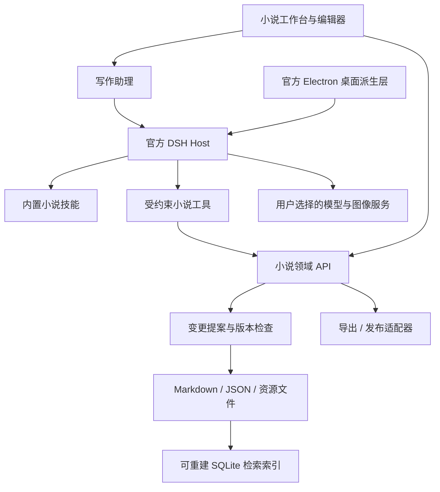

# 架构设计

## 决策 ADR-001：官方桌面 + 官方 Agent + 小说领域插件

状态：Stage-001 集成中。Agent 使用官方 DeepSeek Harness 0.2.1-rc.2。Electron 44.7.0 跟随固定上游桌面版本；本项目消费已发布包，使用本地可用的 pnpm 10.3.0 和独立锁文件。上游源码构建要求 pnpm 11.28.5，不混用两份工作区。

### 2026-10-22 集成评估与修正

完整官方 desktop-host 会带入通用 Office 宿主、账户浏览器及其他产品耦合。为满足小说专用要求，派生官方 Electron 生命周期和 Node 子进程启动方法，保留原始文件与 MIT 来源；小说 UI/preload 自行实现，在桌面内启动官方公开 SDK 的 `sdk-minimal` profile。并非原封不动运行整个官方 desktop UI，也不另写 Agent loop。图中的 Host 具体实现为官方 DSH CLI + SDK JSON-RPC。

官方 `sdk-minimal` 默认仍有终端和图片文件读取工具。`novel.patch.yml` 明确禁用这些生产者；每次任务创建独立 home/cwd 和冻结选区文件，只注册 `novel_selection_read`、`novel_change_propose`。工具只接触宿主给定的两个任务文件，无正式稿路径参数。全局 guard 拒绝其他工具。每个任务使用环境变量白名单，避免继承其他项目密钥或 NODE_OPTIONS。

实测官方 Agent 完成了选区读取→候选工具→最终响应三个模型请求；模型服务是本机 SSE fixture，不能代表真实供应商/文本质量验证。详细机器回执在 `assessments/stage-001/`。

首轮编辑器实验使用原生 textarea，以最少依赖验证 IME/保存/选区基线。富文本、虚拟长文和结构化差异仍待 Stage-002 编辑器对比，不把 textarea 当作最终编辑器决定。存储 v1 暂在 book.json 中内嵌稳定 ID 章节目录；卷/场景与索引迁移将保持 Markdown 正文独立。

## 模块与责任

| 拟建模块 | 责任 | 不负责 |
| --- | --- | --- |
| apps/desktop | 生命周期、文件对话框、独立 profile、升级、恢复 | 小说规则、模型推理循环 |
| packages/novel-domain | 书卷章场景、设定、线索、版本和状态机 | Electron/DSH SDK 依赖 |
| packages/novel-storage | 文件事务、日志、快照、迁移、文件监视、单写入者 | 云模型、编辑器 UI |
| packages/novel-workbench | 书架、正文编辑、设定板、阅读、差异 | 任意本地文件访问 |
| packages/novel-harness | DSH/Cordis 服务注册、任务与模型事件适配 | 重建 Agent loop |
| packages/novel-context | 引用、检索、正典筛选、上下文预算 | 静默更改正文 |
| packages/novel-assets | 图像候选、地图数据、关联与资源清单 | 默认加载第三方市场 |
| packages/novel-publishing | 本地输出、阅读站、远端回执 | 假设全平台 API 都可用 |
| skills | 可移植创作方法和结果约定 | 授权、文件写入执行器 |

以上是目标模块，不创建空实现冒充接入。所有功能只通过小说域 API 更新实体，手工编辑与 AI 不用两套存储。

## ADR-002：最小小说 profile

保留：Host/Cordis、模型接入、会话、工具路由、技能、任务状态、存储、必要权限、网络适配与本地文件基础设施。产品入口只有书库、写作、规划、设定、素材、审读、发布、设置。

默认不加载：编程工具包、任意 shell/终端、Git 面板、Office 套件、CRM/金融、IM、远控、通用浏览器操控、插件市场。网页资料检索和图像生成在用户配置供应商后按需开启。导出 DOCX/PDF 使用专用转换器，不据此装入整套通用办公产品。

DSH 的内部依赖可能包含共享底层库，“不内置额外功能”按实际加载的插件、可调用工具、UI 和网络行为验收，不能仅从包名判断。Stage-001 产出加载清单、工具清单、允许联网目标、排除项证据。

## ADR-003：编辑器与宿主隔离

编辑器候选为基于 ProseMirror/Tiptap 的富文本 Markdown 体验；具体库尚未选型，需先用中文输入、长章、选区定位、Markdown 往返测试做小实验。正文使用受控 Markdown 子集，扩展批注和实体引用存 sidecar，不把全部稿件藏进厂商私有富文本 JSON。

正式稿目录只允许领域写入服务写入。模型只拿到提案工具，不拥有绕过提案的任意文件写入或 shell。仅隐藏工具按钮不构成隔离；Host 必须实际限制工具集和文件访问，进行绕过测试。导入网页/文档/技能内容属于资料，不能改变操作授权。

## ADR-004：任务可恢复而有界

任务记录 taskId/bookId/目标章节/基线版本/skillVersion/modelId/预算/读写能力/检查点。queued → running → awaiting-review → applied；分支状态 paused/cancelled/failed，外部操作未知用 unknown。续写不重复领取已写范围；取消停止后续调用，保留已收到候选。重启只恢复任务记录，不把不明远端结果直接重试。

多 Agent 是后续可选能力；同一稿件单写入者，作者与审读者读取冻结快照、返回提案。首版不依赖自动多 Agent 才能写作。任务全局并发、单书并发、图片并发独立限额；模型费用估计与供应商实际计费分开。

## 运维边界

独立应用名、appId、DSH_HOME、profile、缓存、更新源和日志。默认仅 loopback；无遥测上传，诊断脱敏。密钥进入 OS 安全存储或受保护本地存储，设置导出只导出键名和非敏感配置。手工编辑路径独立于 AI Host 健康状态，Host 崩溃时仍能保存和导出已打开稿件。

打包包含执行所需运行时，不能要求用户预装另一个桌面应用。正式发布前检查实际安装、退出、后台任务、中文路径、休眠恢复、升级回滚、签名状态与完整依赖清单。保留可运行 Windows 目录和 EXE，不生成 ZIP。
